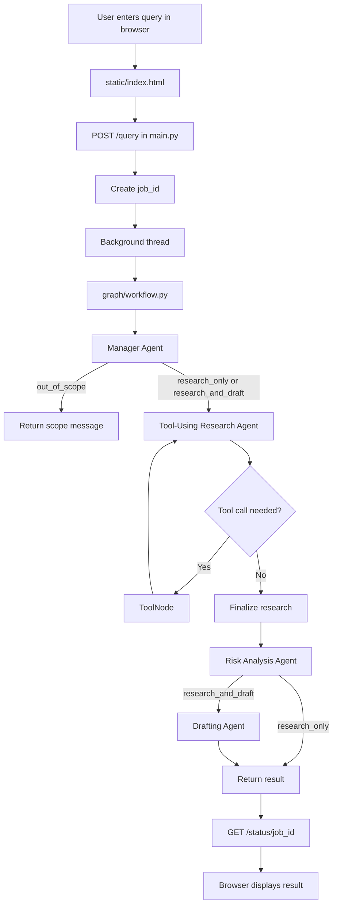

# Enterprise Legal & Compliance Multi-Agent System

An AI-assisted legal and compliance research dashboard that reviews policy and contract questions, retrieves evidence from uploaded PDFs, checks current regulatory information, scores contract risk, and produces optional drafts.

> **Responsible use:** This is a research-support and demonstration system, not a substitute for qualified legal advice.

## Screenshots


## What it does

- Routes each request through a **Manager Agent**.
- Uses a **Research Agent** with internal PDF retrieval, regulatory web search, contract-risk scoring, and company verification tools.
- Runs a separate **Risk Analysis Agent** to summarize risk level, factors, and urgency.
- Uses a **Drafting Agent** when the user requests a notice, letter, memo, or similar document.
- Shows live workflow progress in the browser dashboard.
- Supports PDF knowledge-base uploads, case-document uploads, conversation history, and audit logs.

## Workflow

```text
Browser Dashboard
        |
     FastAPI
        |
  Manager Agent
        |
  Research Agent <--> Tools
        |
  Risk Analysis Agent
        |
  Drafting Agent (when requested)
        |
   Result + Audit Log
```




## Tech stack

| Area | Technology |
|---|---|
| Backend | Python, FastAPI, Uvicorn |
| AI/LLM | Groq, LangChain, LangGraph |
| Knowledge base | PDF parsing, Hugging Face embeddings, ChromaDB or Supabase |
| External research | DuckDuckGo Search, optional Tavily |
| Company verification | OpenCorporates API |
| Memory | LangGraph checkpointing, SQLite option, Supabase threads/messages/audit logs |
| Frontend | HTML, CSS, JavaScript browser dashboard |
| Testing | Pytest |

## Quick start

From the project folder on Windows:

```powershell
python -m venv venv
venv\Scripts\activate
pip install -r requirements.txt
copy .env.example .env
```

Add your credentials to `.env`:

```env
GROQ_API_KEY=your_groq_api_key
SUPABASE_URL=https://your-project.supabase.co
SUPABASE_KEY=your_supabase_key
VECTOR_BACKEND=supabase
```

Start the application:

```powershell
uvicorn main:app --reload --port 8000
```

Open the dashboard at [http://127.0.0.1:8000](http://127.0.0.1:8000). API documentation is available at [http://127.0.0.1:8000/docs](http://127.0.0.1:8000/docs).

## Using the knowledge base

1. Upload trusted policy, compliance, or contract-reference PDFs.
2. Rebuild the knowledge base.
3. Upload a case agreement separately when it needs review.
4. Ask a short question such as:

> Review this agreement, summarize its important terms, and identify any risks or clauses that do not follow the company policies in the Knowledge Base.

## Main API endpoints

| Method | Endpoint | Purpose |
|---|---|---|
| `POST` | `/upload` | Upload a knowledge-base PDF |
| `POST` | `/case-documents` | Upload an agreement for review |
| `POST` | `/rebuild-knowledge-base` | Re-index knowledge-base documents |
| `POST` | `/query` | Start a multi-agent analysis job |
| `GET` | `/status/{job_id}` | Read progress and final results |
| `GET` | `/audit-log` | View recent completed decisions |
| `GET` | `/health` | Check service configuration |

## Project structure

```text
Aiagent/
├── agents/              # Manager, research, risk, and drafting agents
├── graph/workflow.py    # LangGraph orchestration
├── memory/              # Checkpoint and audit-log persistence
├── rag/                 # PDF/vector-store retrieval
├── static/index.html    # Browser dashboard
├── main.py              # FastAPI application
├── tools.py             # Research and compliance tools
├── tests/               # Automated tests
└── requirements.txt
```

## Testing

```powershell
venv\Scripts\python.exe -m pytest -q
```

## Limitations

- Results depend on the documents indexed and the quality/availability of external services.
- LLM output and risk scores must be reviewed by a qualified professional.
- Never upload confidential agreements without authorization.
- Demo deployments should restrict CORS, use durable storage, and protect API credentials.

## License

Add the project license here before public distribution.